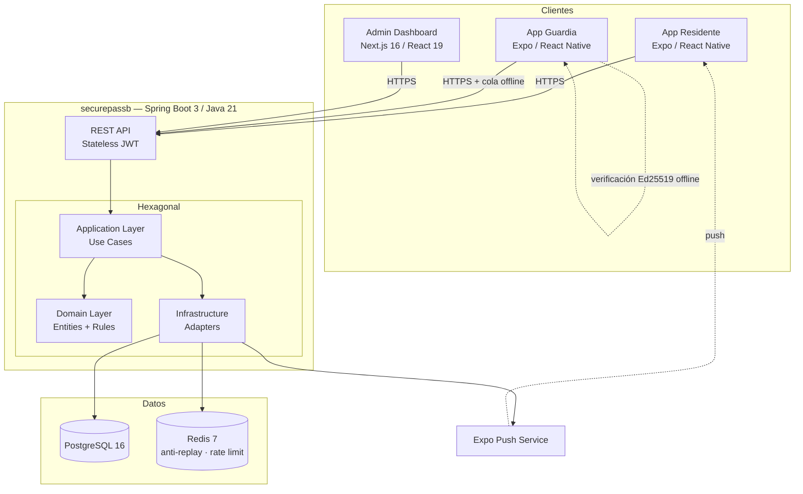
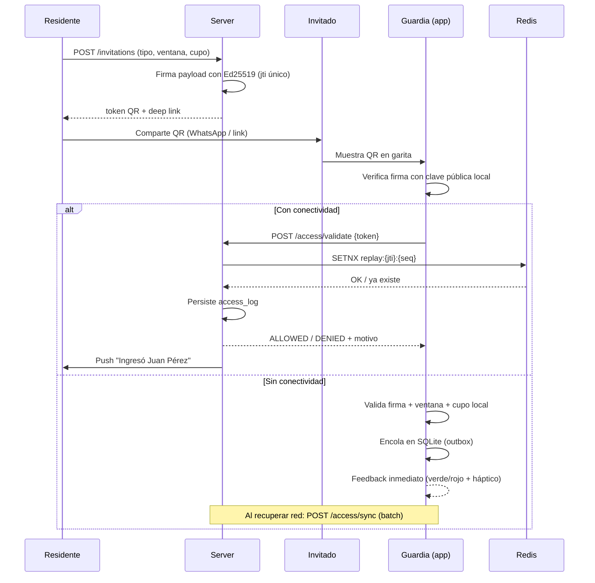
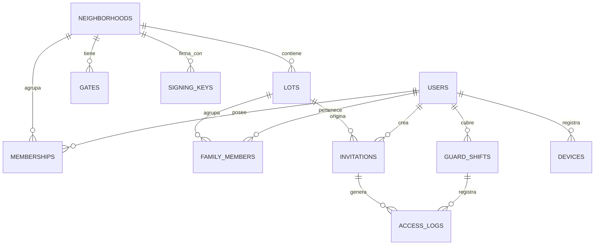
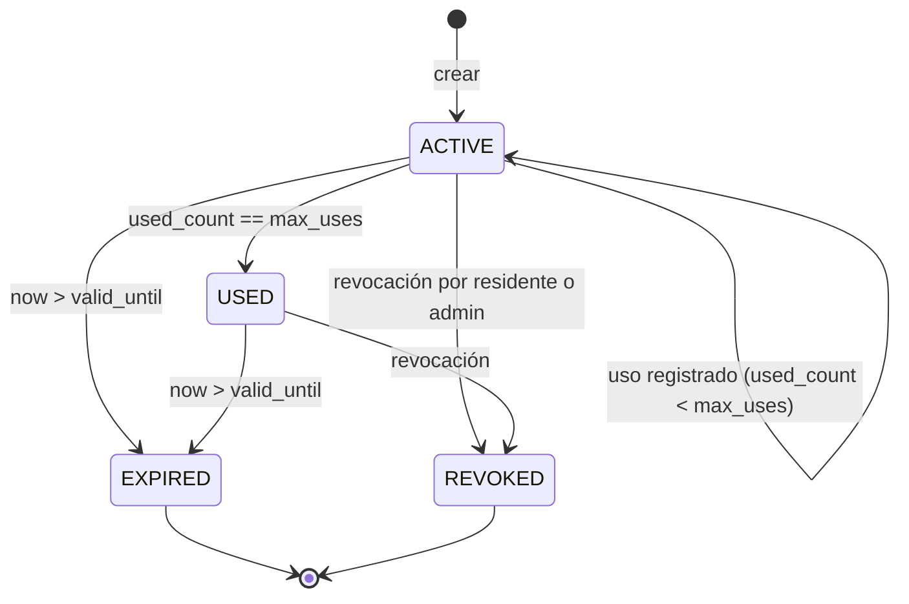

# Securepass — Software Design Document (SDD)

> Fuente de verdad única del proyecto. Todo issue, rama y commit debe poder trazarse a una sección de este documento.
> Versión: 1.0.0 · Estado: Aprobado para implementación · Última actualización: 2026-08-18

---

## 0. Decisiones tomadas y supuestos

Estos puntos estaban ambiguos en el brief. Se resuelven acá; si alguno no coincide con la intención, corregirlo antes de abrir la Fase 0.

| # | Tema | Decisión |
|---|---|---|
| D-01 | Repositorios | `securepassb` (backend Java) y `securepassf` (frontend: mobile + web admin). El brief decía "securepassf y securepassf"; se asume typo. |
| D-02 | Patente / matrícula | **Fuera de alcance del MVP.** Ni captura manual ni OCR. Anotar la patente en garita agrega ~15 s por vehículo y rompe el objetivo del producto. Se difiere a v2 con cámaras LPR fijas. La columna `plate` existe en `access_logs` como `NULL` para no requerir migración destructiva después. |
| D-03 | Plataforma primaria | Mobile. El guardia opera 100% con teléfono. El dashboard admin es web pero **secundario** (Fase 6) y no bloquea la operación. |
| D-04 | Runtime mobile | Expo con compatibilidad **Expo Go**. Esto prohíbe librerías con código nativo custom: no VisionCamera, no MMKV, no WatermelonDB. Reemplazos definidos en §2.2. |
| D-05 | Firma del QR | **Ed25519 (asimétrica)**, no HMAC. Razón en §5.1: el guardia valida offline, y con HMAC habría que guardar el secreto de firma en el teléfono, lo que permitiría falsificar invitaciones desde un dispositivo robado. |
| D-06 | Lectura de DNI (PDF417) | Dentro del MVP, Fase 4. Acelera la visita imprevista en vez de frenarla, que es lo contrario del caso de la patente. |
| D-07 | Alcance de código | Sin capas especulativas. No se implementa multi-tenant por schema, no se implementa event sourcing, no se implementa GraphQL. Un barrio por fila en `neighborhoods` y punto. |

---

## 1. System Overview

### 1.1 Problema

En la garita de un barrio privado el cuello de botella es la **identificación del visitante**: el guardia llama al residente por teléfono, espera, anota datos a mano en un cuaderno. Tiempo típico por visita imprevista: 60–120 s. Con cola de autos, se degrada rápido.

Securepass reduce eso a un escaneo de QR de ~2 s, y deja como subproducto una bitácora inmutable y auditable.

### 1.2 Actores

| Actor | Rol técnico | Superficie |
|---|---|---|
| Dueño / Administrador del barrio | `ADMIN` | Web (Next.js) + Mobile |
| Guardia de seguridad | `GUARD` | Mobile (modo garita) |
| Titular del lote | `RESIDENT_OWNER` | Mobile |
| Miembro de la unidad familiar | `RESIDENT_MEMBER` | Mobile |
| Invitado | — sin cuenta — | Recibe QR por WhatsApp / link |

### 1.3 Diagrama de arquitectura



### 1.4 Flujo principal: invitación → ingreso



---

## 2. Stack tecnológico

### 2.1 Backend — `securepassb`

| Componente | Elección | Motivo |
|---|---|---|
| Lenguaje | Java 21 (LTS) | Records, sealed interfaces, pattern matching para el resultado de validación |
| Framework | Spring Boot 3.3+ | — |
| Build | **Gradle (Kotlin DSL)** | — |
| Persistencia | Spring Data JPA + Hibernate 6 | — |
| DB | PostgreSQL 16 | — |
| Cache / anti-replay | Redis 7 | TTL nativo = expiración automática de nonces |
| Migraciones | Flyway | Versionadas, nunca `ddl-auto: update` |
| Seguridad | Spring Security, JWT stateless (HS256 sesión) + Ed25519 (QR) | — |
| Criptografía QR | `java.security` EdDSA (JEP 339, nativo desde JDK 15) | Sin dependencia externa |
| Validación | Bean Validation (Jakarta) | — |
| Mapeo | MapStruct | Sin reflection en runtime |
| Tests | JUnit 5 + Testcontainers + RestAssured | — |
| Docs | springdoc-openapi | `/swagger-ui.html` |

### 2.2 Mobile — `securepassf/mobile`

Restricción dura: **debe correr en Expo Go**. Sustituciones respecto del brief original:

| Brief original | Reemplazo | Motivo |
|---|---|---|
| react-native-vision-camera | `expo-camera` | VisionCamera requiere build nativo. `expo-camera` escanea `qr` y `pdf417` en iOS y Android. |
| MMKV | `expo-secure-store` (tokens) + `AsyncStorage` (cache liviano) | MMKV es módulo nativo |
| WatermelonDB | `expo-sqlite` | Ya decidido en sesión previa |

| Componente | Elección |
|---|---|
| Framework | Expo SDK 52+ / React Native + TypeScript strict |
| Navegación | `expo-router` (file-based) |
| Estado servidor | TanStack Query v5 + persister sobre SQLite |
| Estado local | Zustand (solo sesión y modo garita) |
| DB local | `expo-sqlite` |
| Cámara | `expo-camera` |
| Cripto | `@noble/ed25519` (JS puro, verificación offline) |
| Push | `expo-notifications` |
| Háptica | `expo-haptics` |
| Estilos | `nativewind` v4 (Tailwind en RN) |

### 2.3 Web Admin — `securepassf/web`

Next.js 16 (App Router) · React 19 · Tailwind CSS 4 · `@base-ui/react` / shadcn · TanStack Query.

---

## 3. Estructura de repositorios

### 3.1 `securepassb` (backend, hexagonal por módulo de dominio)

```text
securepassb/
  build.gradle.kts
  docker-compose.yml            # postgres + redis para dev local
  src/main/java/com/securepass/
    SecurepassApplication.java
    shared/
      config/                   # SecurityConfig, RedisConfig, JacksonConfig
      exception/                # GlobalExceptionHandler, ApiError
      security/                 # JwtService, CurrentUser, RoleGuard
      crypto/                   # Ed25519Signer, Ed25519Verifier
    modules/
      identity/                 # usuarios, roles, auth
        domain/                 # User, Role, UserId (entidades + reglas puras)
        application/            # LoginUseCase, RefreshTokenUseCase
        infrastructure/
          persistence/          # UserJpaEntity, UserRepositoryAdapter
          rest/                 # AuthController, dto/
      neighborhood/             # barrios, lotes, unidades familiares
      invitation/               # invitaciones, tokens QR, máquina de estados
      access/                   # validación, access_logs, sync offline
      shift/                    # turnos de guardia
      notification/             # push a residentes
  src/main/resources/
    db/migration/               # V1__init.sql, V2__...
    application.yml
  src/test/java/...
```

Reglas hexagonales:

1. `domain/` no importa Spring, JPA ni Jackson. Java puro.
2. `application/` define **puertos** (interfaces). `infrastructure/` los implementa.
3. Un módulo no importa clases de `domain/` de otro módulo: se comunica vía puertos de `application/` o eventos.
4. Los controllers no reciben ni devuelven entidades JPA. Solo `record` DTOs.

### 3.2 `securepassf` (monorepo frontend)

```text
securepassf/
  package.json                  # workspaces: mobile, web, packages/*
  packages/
    contracts/                  # tipos TS generados desde OpenAPI — fuente única
  mobile/
    app/                        # expo-router
      (auth)/login.tsx
      (guard)/scanner.tsx
      (resident)/index.tsx
    src/
      modules/
        scanner/
          types.ts
          data.ts
          lib.ts
          hooks.ts
          components/
          scanner-view.tsx
        invitation/
        access-history/
        family/
      common/
        api/                    # cliente HTTP + hooks React Query
        components/             # design system
        db/                     # esquema SQLite + outbox
        lib/
        providers/
  web/
    src/
      modules/
        dashboard/
        registry/               # padrón catastral
        audit/
      common/
        api/ components/ layout/ lib/ providers/
```

Reglas de módulo (obligatorias, aplican a `mobile/` y `web/`):

1. Types → `module/types.ts`. Nunca inline en vistas o hooks.
2. Constantes → `module/data.ts`.
3. Funciones puras → `module/lib.ts`. Sin React adentro.
4. Hooks → `module/hooks.ts`.
5. Código usado por 2+ módulos → `common/`.
6. La única interface permitida inline en un componente es su `Props`.
7. Archivos de `common/api/hooks/` contienen **solo hooks**; los tipos se re-exportan desde el módulo.

---

## 4. Modelo de datos

### 4.1 ERD



### 4.2 DDL — `V1__init.sql`

```sql
CREATE EXTENSION IF NOT EXISTS "pgcrypto";

-- ============================================================
-- BARRIOS Y ACCESOS FÍSICOS
-- ============================================================
CREATE TABLE neighborhoods (
    id              UUID PRIMARY KEY DEFAULT gen_random_uuid(),
    name            VARCHAR(120)  NOT NULL,
    slug            VARCHAR(60)   NOT NULL UNIQUE,
    timezone        VARCHAR(60)   NOT NULL DEFAULT 'America/Argentina/Mendoza',
    -- minutos tras los cuales una permanencia sin egreso dispara alerta
    stay_alert_minutes INT        NOT NULL DEFAULT 480,
    active          BOOLEAN       NOT NULL DEFAULT TRUE,
    created_at      TIMESTAMPTZ   NOT NULL DEFAULT now(),
    updated_at      TIMESTAMPTZ   NOT NULL DEFAULT now()
);

CREATE TABLE gates (
    id              UUID PRIMARY KEY DEFAULT gen_random_uuid(),
    neighborhood_id UUID NOT NULL REFERENCES neighborhoods(id) ON DELETE CASCADE,
    name            VARCHAR(80) NOT NULL,
    direction       VARCHAR(10) NOT NULL CHECK (direction IN ('IN','OUT','BOTH')),
    active          BOOLEAN     NOT NULL DEFAULT TRUE,
    UNIQUE (neighborhood_id, name)
);

-- Claves Ed25519 para firma de QR. La privada nunca sale del server.
CREATE TABLE signing_keys (
    id              UUID PRIMARY KEY DEFAULT gen_random_uuid(),
    neighborhood_id UUID NOT NULL REFERENCES neighborhoods(id) ON DELETE CASCADE,
    kid             VARCHAR(16) NOT NULL,           -- key id embebido en el QR
    public_key      TEXT        NOT NULL,           -- base64url, distribuida a guardias
    private_key_enc TEXT        NOT NULL,           -- cifrada con master key de entorno
    active          BOOLEAN     NOT NULL DEFAULT TRUE,
    rotated_at      TIMESTAMPTZ,
    created_at      TIMESTAMPTZ NOT NULL DEFAULT now(),
    UNIQUE (neighborhood_id, kid)
);
CREATE UNIQUE INDEX uq_signing_keys_active
    ON signing_keys (neighborhood_id) WHERE active;

-- ============================================================
-- PADRÓN CATASTRAL
-- ============================================================
CREATE TABLE lots (
    id              UUID PRIMARY KEY DEFAULT gen_random_uuid(),
    neighborhood_id UUID NOT NULL REFERENCES neighborhoods(id) ON DELETE CASCADE,
    code            VARCHAR(30) NOT NULL,           -- "M4-L12"
    street          VARCHAR(120),
    number          VARCHAR(20),
    status          VARCHAR(20) NOT NULL DEFAULT 'ACTIVE'
                    CHECK (status IN ('ACTIVE','SUSPENDED','VACANT')),
    created_at      TIMESTAMPTZ NOT NULL DEFAULT now(),
    updated_at      TIMESTAMPTZ NOT NULL DEFAULT now(),
    UNIQUE (neighborhood_id, code)
);

-- ============================================================
-- IDENTIDAD
-- ============================================================
CREATE TABLE users (
    id              UUID PRIMARY KEY DEFAULT gen_random_uuid(),
    email           VARCHAR(160) UNIQUE,
    phone           VARCHAR(30)  UNIQUE,
    password_hash   VARCHAR(120) NOT NULL,
    full_name       VARCHAR(140) NOT NULL,
    document_number VARCHAR(20),
    status          VARCHAR(20) NOT NULL DEFAULT 'ACTIVE'
                    CHECK (status IN ('ACTIVE','SUSPENDED','DELETED')),
    last_login_at   TIMESTAMPTZ,
    created_at      TIMESTAMPTZ NOT NULL DEFAULT now(),
    updated_at      TIMESTAMPTZ NOT NULL DEFAULT now(),
    CONSTRAINT chk_user_contact CHECK (email IS NOT NULL OR phone IS NOT NULL)
);

-- Un usuario puede tener rol en más de un barrio (administradores de varios countries)
CREATE TABLE memberships (
    id              UUID PRIMARY KEY DEFAULT gen_random_uuid(),
    user_id         UUID NOT NULL REFERENCES users(id) ON DELETE CASCADE,
    neighborhood_id UUID NOT NULL REFERENCES neighborhoods(id) ON DELETE CASCADE,
    role            VARCHAR(20) NOT NULL
                    CHECK (role IN ('ADMIN','GUARD','RESIDENT_OWNER','RESIDENT_MEMBER')),
    active          BOOLEAN NOT NULL DEFAULT TRUE,
    created_at      TIMESTAMPTZ NOT NULL DEFAULT now(),
    UNIQUE (user_id, neighborhood_id, role)
);
CREATE INDEX idx_memberships_user ON memberships (user_id) WHERE active;

-- Vínculo usuario <-> lote (unidad familiar)
CREATE TABLE family_members (
    id              UUID PRIMARY KEY DEFAULT gen_random_uuid(),
    lot_id          UUID NOT NULL REFERENCES lots(id) ON DELETE CASCADE,
    user_id         UUID NOT NULL REFERENCES users(id) ON DELETE CASCADE,
    relation        VARCHAR(30),                    -- "Titular", "Hijo/a", "Inquilino"
    is_owner        BOOLEAN NOT NULL DEFAULT FALSE, -- administra la unidad familiar
    can_invite      BOOLEAN NOT NULL DEFAULT TRUE,  -- permiso delegado
    active          BOOLEAN NOT NULL DEFAULT TRUE,
    created_at      TIMESTAMPTZ NOT NULL DEFAULT now(),
    UNIQUE (lot_id, user_id)
);
CREATE INDEX idx_family_members_lot ON family_members (lot_id) WHERE active;

-- ============================================================
-- INVITACIONES
-- ============================================================
CREATE TABLE invitations (
    id              UUID PRIMARY KEY DEFAULT gen_random_uuid(),
    neighborhood_id UUID NOT NULL REFERENCES neighborhoods(id) ON DELETE CASCADE,
    lot_id          UUID NOT NULL REFERENCES lots(id) ON DELETE RESTRICT,
    created_by      UUID NOT NULL REFERENCES users(id) ON DELETE RESTRICT,

    type            VARCHAR(20) NOT NULL
                    CHECK (type IN ('SINGLE','EVENT','RECURRING')),
    status          VARCHAR(20) NOT NULL DEFAULT 'ACTIVE'
                    CHECK (status IN ('ACTIVE','USED','EXPIRED','REVOKED')),

    guest_name      VARCHAR(140) NOT NULL,
    guest_document  VARCHAR(20),
    companions      SMALLINT NOT NULL DEFAULT 0 CHECK (companions BETWEEN 0 AND 20),
    notes           VARCHAR(280),

    valid_from      TIMESTAMPTZ NOT NULL,
    valid_until     TIMESTAMPTZ NOT NULL,
    -- Solo RECURRING: días de semana (1=lunes) y franja horaria local
    weekdays        SMALLINT[],
    daily_from      TIME,
    daily_until     TIME,

    max_uses        INT NOT NULL DEFAULT 1 CHECK (max_uses > 0),
    used_count      INT NOT NULL DEFAULT 0 CHECK (used_count >= 0),

    token_kid       VARCHAR(16) NOT NULL,
    revoked_at      TIMESTAMPTZ,
    revoked_by      UUID REFERENCES users(id),
    created_at      TIMESTAMPTZ NOT NULL DEFAULT now(),
    updated_at      TIMESTAMPTZ NOT NULL DEFAULT now(),

    CONSTRAINT chk_window CHECK (valid_until > valid_from),
    CONSTRAINT chk_uses   CHECK (used_count <= max_uses),
    CONSTRAINT chk_single CHECK (type <> 'SINGLE' OR max_uses = 1),
    CONSTRAINT chk_recurring_slot CHECK (
        type <> 'RECURRING' OR (weekdays IS NOT NULL AND daily_from IS NOT NULL AND daily_until IS NOT NULL)
    )
);
CREATE INDEX idx_invitations_lot     ON invitations (lot_id, created_at DESC);
CREATE INDEX idx_invitations_active  ON invitations (neighborhood_id, status)
    WHERE status = 'ACTIVE';

-- ============================================================
-- TURNOS DE GUARDIA
-- ============================================================
CREATE TABLE guard_shifts (
    id              UUID PRIMARY KEY DEFAULT gen_random_uuid(),
    neighborhood_id UUID NOT NULL REFERENCES neighborhoods(id) ON DELETE CASCADE,
    gate_id         UUID NOT NULL REFERENCES gates(id) ON DELETE RESTRICT,
    guard_id        UUID NOT NULL REFERENCES users(id) ON DELETE RESTRICT,
    started_at      TIMESTAMPTZ NOT NULL DEFAULT now(),
    ended_at        TIMESTAMPTZ,
    handover_notes  TEXT,
    CONSTRAINT chk_shift_window CHECK (ended_at IS NULL OR ended_at > started_at)
);
CREATE UNIQUE INDEX uq_guard_open_shift
    ON guard_shifts (guard_id) WHERE ended_at IS NULL;
CREATE INDEX idx_shifts_gate ON guard_shifts (gate_id, started_at DESC);

-- ============================================================
-- BITÁCORA DE ACCESOS (append-only)
-- ============================================================
CREATE TABLE access_logs (
    id              UUID PRIMARY KEY DEFAULT gen_random_uuid(),
    neighborhood_id UUID NOT NULL REFERENCES neighborhoods(id) ON DELETE RESTRICT,
    gate_id         UUID NOT NULL REFERENCES gates(id) ON DELETE RESTRICT,
    shift_id        UUID REFERENCES guard_shifts(id) ON DELETE SET NULL,
    guard_id        UUID REFERENCES users(id) ON DELETE SET NULL,
    invitation_id   UUID REFERENCES invitations(id) ON DELETE SET NULL,
    lot_id          UUID REFERENCES lots(id) ON DELETE SET NULL,
    user_id         UUID REFERENCES users(id) ON DELETE SET NULL, -- residente propio

    direction       VARCHAR(3)  NOT NULL CHECK (direction IN ('IN','OUT')),
    subject_type    VARCHAR(20) NOT NULL
                    CHECK (subject_type IN ('GUEST','RESIDENT','SERVICE','MANUAL')),
    result          VARCHAR(20) NOT NULL
                    CHECK (result IN ('ALLOWED','DENIED')),
    denial_reason   VARCHAR(30)
                    CHECK (denial_reason IN (
                        'INVALID_SIGNATURE','NOT_YET_VALID','EXPIRED',
                        'ALREADY_USED','REVOKED','OUT_OF_SCHEDULE',
                        'LOT_SUSPENDED','REPLAY','DOCUMENT_MISMATCH','UNKNOWN')),
                    -- DOCUMENT_MISMATCH (V4): el DNI cargado al enrolar no es el de la
                    -- invitacion o del trabajador detras del QR ("le prestaron el QR")

    subject_name    VARCHAR(140),
    subject_document VARCHAR(20),
    companions      SMALLINT NOT NULL DEFAULT 0,
    plate           VARCHAR(15),                   -- reservado v2 (LPR), siempre NULL en MVP

    token_jti       UUID,                          -- correlación anti-replay
    -- Trazabilidad offline
    captured_at     TIMESTAMPTZ NOT NULL,          -- reloj del dispositivo en garita
    recorded_at     TIMESTAMPTZ NOT NULL DEFAULT now(), -- llegada al server
    synced_offline  BOOLEAN NOT NULL DEFAULT FALSE,
    client_event_id UUID NOT NULL,                 -- idempotencia de sync

    CONSTRAINT chk_denial CHECK (
        (result = 'DENIED' AND denial_reason IS NOT NULL) OR
        (result = 'ALLOWED' AND denial_reason IS NULL)
    ),
    CONSTRAINT uq_client_event UNIQUE (client_event_id)
);
CREATE INDEX idx_logs_neighborhood_time ON access_logs (neighborhood_id, captured_at DESC);
CREATE INDEX idx_logs_invitation        ON access_logs (invitation_id);
CREATE INDEX idx_logs_lot               ON access_logs (lot_id, captured_at DESC);
CREATE INDEX idx_logs_open_stay         ON access_logs (neighborhood_id, direction, captured_at)
    WHERE result = 'ALLOWED';

-- Inmutabilidad: sin UPDATE ni DELETE sobre la bitácora
CREATE OR REPLACE FUNCTION deny_mutation() RETURNS TRIGGER AS $$
BEGIN
    RAISE EXCEPTION 'access_logs es append-only';
END;
$$ LANGUAGE plpgsql;

CREATE TRIGGER trg_access_logs_immutable
    BEFORE UPDATE OR DELETE ON access_logs
    FOR EACH ROW EXECUTE FUNCTION deny_mutation();

-- ============================================================
-- DISPOSITIVOS (push)
-- ============================================================
CREATE TABLE devices (
    id              UUID PRIMARY KEY DEFAULT gen_random_uuid(),
    user_id         UUID NOT NULL REFERENCES users(id) ON DELETE CASCADE,
    expo_push_token VARCHAR(200) NOT NULL UNIQUE,
    platform        VARCHAR(10) NOT NULL CHECK (platform IN ('IOS','ANDROID')),
    last_seen_at    TIMESTAMPTZ NOT NULL DEFAULT now(),
    created_at      TIMESTAMPTZ NOT NULL DEFAULT now()
);
CREATE INDEX idx_devices_user ON devices (user_id);
```

### 4.3 Reglas de negocio del dominio

| ID | Regla |
|---|---|
| BR-01 | Solo `family_members` con `can_invite = TRUE` y `active = TRUE` pueden crear invitaciones para ese lote. |
| BR-02 | `is_owner = TRUE` puede además revocar invitaciones de cualquier miembro del lote y gestionar permisos. |
| BR-03 | Un lote con `status <> 'ACTIVE'` rechaza toda invitación nueva y toda validación de QR (`LOT_SUSPENDED`). |
| BR-04 | `valid_until - valid_from` ≤ 30 días para `SINGLE`/`EVENT`, ≤ 365 días para `RECURRING`. |
| BR-05 | `max_uses` de `EVENT` ≤ 200. Por encima, se requiere aprobación de `ADMIN`. |
| BR-06 | El `used_count` se incrementa **solo** en `direction = 'IN'` con `result = 'ALLOWED'`. Los egresos no consumen cupo. |
| BR-07 | Un egreso sin ingreso previo registrado se acepta y se marca `subject_type = 'MANUAL'` (no se bloquea a nadie la salida). |
| BR-08 | Alerta de permanencia excedida: ingreso `ALLOWED` sin egreso correspondiente pasadas `stay_alert_minutes`. |
| BR-09 | Un guardia no puede tener dos turnos abiertos simultáneos (garantizado por índice `uq_guard_open_shift`). |
| BR-10 | El residente puede escanear su propio QR personal (permanente, `RECURRING` implícito) sin consumir cupo. |

---

## 5. Seguridad

### 5.1 Token QR — diseño

**Por qué Ed25519 y no HMAC.** El guardia debe validar sin conectividad. Con HMAC-SHA256, la única forma de validar en el dispositivo es que el dispositivo tenga el secreto compartido; y quien tiene el secreto puede *emitir* invitaciones válidas. Un teléfono de garita robado o rooteado se convierte en una fábrica de accesos. Con Ed25519 el teléfono guarda solo la clave **pública**: puede verificar, no puede firmar.

Formato del token (string en el QR):

```text
SP1.<payload_b64url>.<signature_b64url>
```

`payload` (JSON compacto, claves de una letra para densidad de QR):

```json
{
  "v": 1,
  "k": "np_2026a",
  "j": "8f3c...",
  "n": "b1a2...",
  "l": "c9d8...",
  "i": "7e6f...",
  "t": "S",
  "f": 1755523200,
  "u": 1755566400,
  "m": 1
}
```

| Clave | Significado |
|---|---|
| `v` | versión del formato |
| `k` | `kid` de la clave de firma |
| `j` | `jti` — nonce único de la invitación (UUID) |
| `n` | `neighborhoodId` |
| `l` | `lotId` |
| `i` | `invitationId` |
| `t` | tipo: `S` single, `E` event, `R` recurring |
| `f` / `u` | `validFrom` / `validUntil` (epoch segundos, UTC) |
| `m` | `maxUses` |
| `w` | `weekdays` — días de semana (1=lunes). Solo `RECURRING`. |
| `df` / `du` | `dailyFrom` / `dailyUntil` — franja horaria `HH:mm`. Solo `RECURRING`. |

Ejemplo para `t == "R"`:

```json
{
  "v": 1,
  "k": "np_2026a",
  "j": "8f3c...",
  "n": "b1a2...",
  "l": "c9d8...",
  "i": "7e6f...",
  "t": "R",
  "f": 1755523200,
  "u": 1787155200,
  "m": 1,
  "w": [1,2,3,4,5],
  "df": "08:00",
  "du": "18:00"
}
```

`w`, `df` y `du` solo se emiten cuando `t == "R"`; en `SINGLE` y `EVENT`
se omiten, no van en null. Sin estos campos en el token, la validación
offline de pases recurrentes es imposible: el dispositivo no tiene acceso
al horario persistido en `invitations`.

Restricciones:

- Tamaño objetivo < 300 bytes → QR versión ≤ 10, ECC nivel M. Legible a 30 cm con cámara de gama baja.
- El payload **no** lleva datos personales del invitado. El nombre se resuelve server-side. Un QR fotografiado y filtrado no expone identidad.
- El token no es un JWT: se evita el header JSON de JWT que agrega ~40 bytes inútiles al QR.

### 5.2 Anti-replay

Dos capas:

**Online (Redis).** Al validar:

```text
SETNX  replay:{jti}:{usedCount+1}  {clientEventId}   EX = valid_until - now + 300s
```

Si la clave ya existe con otro `clientEventId` → `DENIED / REPLAY`. Si existe con el mismo → respuesta idempotente (reintento de red, no ataque).

El incremento de `used_count` y el `INSERT` en `access_logs` ocurren en una transacción con `SELECT ... FOR UPDATE` sobre `invitations`, para que dos garitas escaneando el mismo QR simultáneamente no dupliquen el consumo.

**Offline (SQLite local).** Tabla `consumed_tokens(jti, use_seq, captured_at)`. El dispositivo rechaza un `jti` que ya consumió localmente. Al sincronizar, el server resuelve conflictos entre dispositivos con **first-captured-at-wins**; los duplicados se persisten igual con `result = 'DENIED'`, `denial_reason = 'REPLAY'` para que la auditoría muestre el intento en vez de borrarlo.

### 5.3 Autenticación de sesión

| Aspecto | Definición |
|---|---|
| Access token | JWT HS256, TTL 15 min, claims: `sub`, `nid`, `roles[]`, `lots[]` |
| Refresh token | Opaco, 256 bits aleatorios, hash SHA-256 en Redis, TTL 30 días, **rotación en cada uso** |
| Detección de robo | Si se presenta un refresh ya rotado → se invalida toda la familia de tokens de ese usuario |
| Almacenamiento mobile | `expo-secure-store` (Keychain / Keystore). Nunca AsyncStorage. |
| Password | BCrypt, cost 12 |

### 5.4 Rate limiting (Redis, bucket por ventana deslizante)

| Endpoint | Límite |
|---|---|
| `POST /auth/login` | 5 / 15 min por IP + email |
| `POST /invitations` | 30 / hora por usuario |
| `POST /access/validate` | 120 / min por dispositivo de garita |
| `POST /access/sync` | 10 / min por dispositivo |

### 5.5 Checklist transversal

- [ ] Todo endpoint valida `neighborhoodId` del JWT contra el recurso solicitado (prevención de IDOR entre barrios).
- [ ] `@PreAuthorize` explícito en cada método de controller. Sin defaults permisivos.
- [ ] Sin secretos en el repo: `application.yml` lee de variables de entorno.
- [ ] Clave privada Ed25519 cifrada en DB con `SECUREPASS_MASTER_KEY` (AES-GCM).
- [ ] CORS restringido al dominio del admin web.
- [ ] Logs sin PII: nunca loguear tokens completos, documentos ni teléfonos.
- [ ] HTTPS obligatorio; HSTS en el admin web.

---

## 6. Máquina de estados de la invitación



Notas de implementación:

- No existe estado `CREATED` separado: una invitación nace `ACTIVE`. Si `valid_from` es futuro, sigue `ACTIVE` y la validación devuelve `NOT_YET_VALID`. Un estado extra que no cambia ninguna decisión es complejidad muerta.
- `EXPIRED` se **calcula** en lectura y se **materializa** por un job (`@Scheduled`, cada 15 min) para que los índices sirvan. Nunca se depende solo del job para decidir un acceso.
- `USED` y `REVOKED` son terminales respecto de la validación: ambos devuelven `DENIED`.
- Transiciones prohibidas: `REVOKED → ACTIVE`, `USED → ACTIVE`, `EXPIRED → ACTIVE`. Para reactivar hay que emitir una invitación nueva.

Resultado de validación (sealed interface en el dominio):

```java
public sealed interface AccessDecision {
    record Allowed(UUID invitationId, String guestName, String lotCode, int companions)
        implements AccessDecision {}
    record Denied(DenialReason reason, String detail) implements AccessDecision {}
}
```

---

## 7. API Contract

Base: `/api/v1`. Todas las respuestas de error usan RFC 7807 (`application/problem+json`).

### 7.1 Auth

```http
POST /api/v1/auth/login
```
```json
{ "identifier": "juan@mail.com", "password": "..." }
```
```json
{
  "accessToken": "eyJ...",
  "refreshToken": "b64...",
  "expiresIn": 900,
  "user": {
    "id": "uuid", "fullName": "Juan Pérez",
    "neighborhoodId": "uuid", "roles": ["RESIDENT_OWNER"],
    "lots": [{ "id": "uuid", "code": "M4-L12", "canInvite": true, "isOwner": true }]
  }
}
```

| Método | Ruta | Rol | Descripción |
|---|---|---|---|
| POST | `/auth/login` | público | Login |
| POST | `/auth/refresh` | público | Rotación de refresh token |
| POST | `/auth/logout` | autenticado | Invalida la familia de refresh |
| GET | `/me` | autenticado | Perfil + roles + lotes |

### 7.2 Invitaciones (residente)

```http
POST /api/v1/invitations
```
```json
{
  "lotId": "uuid",
  "type": "SINGLE",
  "guestName": "María López",
  "guestDocument": "30123456",
  "companions": 2,
  "validFrom": "2026-08-20T18:00:00Z",
  "validUntil": "2026-08-20T23:59:00Z",
  "maxUses": 1,
  "notes": "Cumpleaños"
}
```
```json
{
  "id": "uuid",
  "status": "ACTIVE",
  "type": "SINGLE",
  "guestName": "María López",
  "validFrom": "2026-08-20T18:00:00Z",
  "validUntil": "2026-08-20T23:59:00Z",
  "maxUses": 1,
  "usedCount": 0,
  "qrToken": "SP1.eyJ2IjoxLCJr....abc123",
  "shareUrl": "https://securepass.app/i/8f3c9a"
}
```

Para `type: "RECURRING"` se agregan `weekdays: [1,2,3,4,5]`, `dailyFrom: "08:00"`, `dailyUntil: "18:00"`.

| Método | Ruta | Rol | Descripción |
|---|---|---|---|
| POST | `/invitations` | RESIDENT_* con `can_invite` | Crear |
| GET | `/invitations?lotId=&status=&page=` | RESIDENT_*, ADMIN | Listar |
| GET | `/invitations/{id}` | dueño del lote, ADMIN | Detalle + QR |
| POST | `/invitations/{id}/revoke` | creador, owner del lote, ADMIN | Revocar |

### 7.3 Accesos (guardia)

```http
POST /api/v1/access/validate
```
```json
{
  "token": "SP1.eyJ2Ijox....abc",
  "gateId": "uuid",
  "direction": "IN",
  "companions": 2,
  "capturedAt": "2026-08-20T18:42:11Z",
  "clientEventId": "uuid-v4-generado-en-el-device"
}
```

`200 OK` — permitido:
```json
{
  "result": "ALLOWED",
  "logId": "uuid",
  "guest": { "name": "María López", "document": "30123456", "companions": 2 },
  "lot": { "code": "M4-L12", "ownerName": "Juan Pérez" },
  "invitation": { "type": "SINGLE", "usedCount": 1, "maxUses": 1, "remaining": 0 }
}
```

`200 OK` — denegado (no es error HTTP: es una respuesta de negocio válida y el guardia necesita el motivo):
```json
{
  "result": "DENIED",
  "reason": "ALREADY_USED",
  "message": "Pase de un solo uso ya utilizado el 20/08 a las 18:12",
  "lot": { "code": "M4-L12" }
}
```

```http
POST /api/v1/access/sync
```
```json
{
  "deviceId": "uuid",
  "events": [
    {
      "clientEventId": "uuid",
      "token": "SP1...",
      "gateId": "uuid",
      "direction": "IN",
      "companions": 0,
      "capturedAt": "2026-08-20T18:42:11Z",
      "localDecision": "ALLOWED"
    },
    {
      "clientEventId": "uuid",
      "token": "SP1...",
      "gateId": "uuid",
      "direction": "IN",
      "companions": 0,
      "capturedAt": "2026-08-20T18:50:03Z",
      "localDecision": "DENIED",
      "localDenialReason": "OUT_OF_SCHEDULE"
    }
  ]
}
```
```json
{
  "accepted": 12,
  "conflicts": [
    { "clientEventId": "uuid", "serverResult": "DENIED", "reason": "REPLAY" }
  ]
}
```

| Método | Ruta | Rol | Descripción |
|---|---|---|---|
| POST | `/access/validate` | GUARD | Validación online |
| POST | `/access/validate-document` | GUARD | Trabajador sin QR (#119): el guardia escanea o carga el DNI; misma respuesta que `/access/validate`. 404 si el DNI no tiene permiso de trabajador en el barrio. Solo con red |
| POST | `/access/sync` | GUARD | Batch offline, idempotente por `clientEventId`. `lotId` opcional por evento, con las mismas reglas que validate y la franja evaluada en el `capturedAt` del evento (#217). Un evento con `lotId` inválido sale `REJECTED` con `rejection: INVALID_LOT`: no se guarda como acceso, deja un WARN con `clientEventId` y guardia, y el resto del batch sigue. `REJECTED` (evento mal formado) no es `DENIED` (decisión de acceso); los dos son terminales. `localDecision` (`ALLOWED` \| `DENIED`) es obligatorio; `localDenialReason` (mismo vocabulario que `reason`) es obligatorio si es `DENIED` y no va si es `ALLOWED`. Si no se cumple (valor desconocido, falta o sobra el motivo), ese evento sale `REJECTED` con `rejection: INVALID_LOCAL_DECISION`, deja un WARN y el resto del batch sigue, igual que `INVALID_LOT`. `WORKER_NOT_SYNCED` y `NEIGHBORHOOD_TZ_MISSING` solo los produce la garita offline (el dispositivo no tenía los datos) y se guardan tal cual: son la señal de una garita desincronizada. Si el guardia cancela el paso del DNI, la garita manda `DENIED` `NOT_ENROLLED` sin `documentNumber`. Un `DENIED` local se guarda con ese motivo sin re-evaluar (§8.4). Un `ALLOWED` local de alguien sin enrolamiento en el barrio sale `DENIED` `NOT_ENROLLED`, auditado y sin consumir el pase. |
| POST | `/access/manual` | GUARD | Ingreso sin QR (proveedor, visita imprevista) |
| GET | `/access/keys` | GUARD | Claves públicas Ed25519 activas del barrio |
| GET | `/access-logs?from=&to=&lotId=&result=&page=` | ADMIN, RESIDENT (solo su lote) | Bitácora |

### 7.4 Turnos

| Método | Ruta | Rol |
|---|---|---|
| POST | `/shifts/open` | GUARD |
| POST | `/shifts/close` | GUARD |
| GET | `/shifts/current` | GUARD |
| GET | `/shifts?gateId=&from=&to=` | ADMIN |

### 7.5 Admin

| Método | Ruta | Descripción |
|---|---|---|
| GET | `/admin/metrics/overview?date=` | Ocupación actual, ingresos/egresos del día, denegados |
| GET | `/admin/metrics/traffic?from=&to=&bucket=hour` | Afluencia por franja horaria |
| GET | `/admin/metrics/overstays` | Permanencias excedidas (BR-08) |
| GET/POST/PATCH | `/admin/lots` | Padrón catastral |
| POST | `/admin/lots/{id}/members` | Vincular usuario a lote |
| GET/POST/PATCH | `/admin/users` | Altas de guardias y residentes |
| GET | `/admin/reports/access-logs.csv` | Export |
| GET | `/admin/reports/access-logs.xlsx` | Export para leer e imprimir en Excel (securepassb#195). Mismos parámetros, rango máximo, límite de concurrencia y auditoría que el CSV. 422 con `rule: export-rows` si el filtro supera el límite de filas del XLSX |

### 7.6 Códigos de error

| HTTP | `type` | Cuándo |
|---|---|---|
| 400 | `validation-error` | Bean Validation fallida |
| 401 | `invalid-credentials` / `token-expired` | Auth |
| 403 | `forbidden` | Rol o barrio incorrecto |
| 404 | `resource-not-found` | — |
| 409 | `state-conflict` | Ej. abrir turno con otro abierto |
| 422 | `business-rule-violation` | Ej. BR-04 excedida |
| 429 | `rate-limit-exceeded` | Incluye header `Retry-After` |

---

## 8. Motor offline del guardia

### 8.1 Esquema SQLite local

```sql
CREATE TABLE consumed_tokens (
  jti          TEXT NOT NULL,
  use_seq      INTEGER NOT NULL,
  captured_at  TEXT NOT NULL,
  PRIMARY KEY (jti, use_seq)
);

CREATE TABLE outbox (
  client_event_id TEXT PRIMARY KEY,
  payload         TEXT NOT NULL,      -- JSON del evento
  created_at      TEXT NOT NULL,
  attempts        INTEGER NOT NULL DEFAULT 0,
  last_error      TEXT
);

CREATE TABLE signing_keys_cache (
  kid         TEXT PRIMARY KEY,
  public_key  TEXT NOT NULL,
  fetched_at  TEXT NOT NULL
);

CREATE TABLE revoked_cache (
  jti         TEXT PRIMARY KEY,
  synced_at   TEXT NOT NULL,
  revoked_at  TEXT            -- revokedAt del server; MAX(revoked_at) es el cursor de since
);

-- WBS-118: padron de trabajadores de GET /access/permissions/sync.
-- Se reemplaza completo en cada sync exitoso (se pide sin `since`).
CREATE TABLE worker_permissions_cache (
  user_id      TEXT NOT NULL,
  jti          TEXT NOT NULL,
  lot_id       TEXT NOT NULL,
  lot_code     TEXT NOT NULL,
  weekdays     TEXT NOT NULL,        -- JSON, ISO 1..7
  daily_from   TEXT NOT NULL,
  daily_until  TEXT NOT NULL,
  timezone     TEXT,                 -- tz de la fila: franja y zona viajan juntas
  PRIMARY KEY (user_id, lot_id)
);

CREATE TABLE worker_enrollments_cache (
  user_id TEXT PRIMARY KEY
);
```

### 8.2 Algoritmo de validación local

```ts
// modules/scanner/lib.ts — función pura, testeable sin React
export const validateOffline = (
  token: string,
  ctx: OfflineContext,
): AccessDecision => {
  const parsed = parseToken(token)
  if (!parsed) return denied('INVALID_SIGNATURE')

  const key = ctx.keys[parsed.payload.k]
  if (!key) return denied('INVALID_SIGNATURE')
  if (!verifyEd25519(parsed, key)) return denied('INVALID_SIGNATURE')

  if (ctx.revoked.has(parsed.payload.j)) return denied('REVOKED')
  if (ctx.now < parsed.payload.f) return denied('NOT_YET_VALID')
  if (ctx.now > parsed.payload.u) return denied('EXPIRED')
  if (parsed.payload.t === 'R' && !withinDailySlot(parsed.payload, ctx.now)) {
    return denied('OUT_OF_SCHEDULE')
  }
  if (ctx.localUses(parsed.payload.j) >= parsed.payload.m) return denied('ALREADY_USED')

  // Allowed explicito: espeja las condiciones de los guards.
  if (noRevocado && dentroDeVentana && enFranja && cupoDisponible) {
    return allowed(parsed.payload)
  }

  // Fail-closed: el default es denegar.
  return denied('UNKNOWN')
}
```

**Default fail-closed.** La última línea es `denied('UNKNOWN')`, no un
fall-through a `allowed`: si una condición nueva se agrega al token y
falta su guard clause, el pase se deniega. El costo de un falso
permitido (un desconocido adentro) es mayor que el de un falso denegado
(un registro manual en garita). `UNKNOWN` se agrega a los motivos
producibles offline.

**Rama del trabajador (WBS-118).** Un token `st: 'W'` no trae ventana,
lote ni cupo. Después de firma y revocación, todo sale de
`worker_permissions_cache`: sin filas para `s` con el mismo `jti` →
`WORKER_NOT_SYNCED` (cache viejo o token rotado, fail-closed); fila sin
tz → `NEIGHBORHOOD_TZ_MISSING`; ningún lote en franja con la tz de cada
fila → `OUT_OF_SCHEDULE`; sin enrolar → pide DNI como al invitado; si no,
permitido con los lotes en franja, que se muestran como información
(el guardia no elige hasta que el backend acepte `lotId`, WBS-119).

### 8.3 Limitaciones aceptadas del modo offline

Se documentan porque son decisiones, no bugs:

1. Una revocación emitida mientras el dispositivo está sin red no se conoce hasta la próxima sync. Mitigación: `revoked_cache` se refresca en cada latido de red (cada 60 s) y la ventana de exposición es corta.
2. El cupo (`max_uses`) se controla por dispositivo. Dos garitas offline simultáneas pueden sobrepasar el cupo de un pase `EVENT`. Se detecta y audita en el sync (`REPLAY`), no se puede prevenir sin red. Para un pase `SINGLE`, el riesgo real es bajo (un solo acceso físico).
3. El reloj del dispositivo se usa como `capturedAt`. Se compara contra `recorded_at` al sincronizar; una desviación > 5 min marca el log con `clock_skew` en auditoría.

### 8.4 Política de sincronización

- **El sync nunca sube un `DENIED` local a `ALLOWED`.** El rechazo de la garita es un hecho físico: el server lo guarda con el `localDenialReason` del evento, sin re-evaluar, sin consumir el pase, sin abrir estadía y sin enrolar. Puede bajar un `ALLOWED` local a `DENIED` (auditado: `REPLAY`, `REVOKED`, `NOT_ENROLLED`, etc.), aunque la persona haya entrado, para que el admin lo vea. Nunca al revés: re-evaluar un rechazo con el permiso del momento del sync inventa ingresos.
- El sync chequea enrolamiento igual que online. La cache local da por enrolado un DNI que el dispositivo no pudo verificar; si el enroll falla en el server (`DOCUMENT_MISMATCH`), los ingresos siguientes sin DNI salen `NOT_ENROLLED`.
- Reintento con backoff exponencial: 5 s → 15 s → 60 s → 5 min, tope 5 min.
- Batch de máximo 50 eventos por request.
- La cola nunca se descarta automáticamente. Si supera 500 eventos, se muestra alerta persistente en la app del guardia.
- La sync arranca por evento de `expo-network` (recuperación de conectividad) y por timer de 60 s.

---

## 9. Design System

Estilo: **Dark minimalist monocromático**. La garita se usa de noche; un fondo claro a las 3 AM es un problema de usabilidad real, no una preferencia estética.

### 9.1 Tokens

```css
--bg-base:      #09090b;   /* fondo app */
--bg-surface:   #121212;   /* cards, sheets */
--bg-elevated:  #1a1a1d;   /* modales, inputs */
--border:       #27272a;   /* bordes tenues */
--text-primary: #fafafa;
--text-muted:   #a1a1aa;
--allow:        #16a34a;   /* solo feedback de escaneo */
--deny:         #dc2626;   /* solo feedback de escaneo */
--warn:         #d97706;   /* pase vencido / fuera de horario */
```

El color aparece **únicamente** en el resultado del escaneo. Toda la interfaz restante es monocromática. Esa restricción es la que hace que el guardia lea el resultado en periferia sin enfocar la pantalla.

**Excepción (#232):** el control Ingreso/Egreso del escáner muestra el modo activo con `allow` (ingreso) o `warn` (egreso) y texto `bg-base`, para que el guardia vea de un vistazo qué va a registrar el próximo QR. Es el único control con color fuera del resultado; también cambia ícono y texto, así no depende solo del color.

### 9.2 Radios

| Elemento | Token |
|---|---|
| Inputs | `rounded-xl` |
| Cards | `rounded-lg` |
| Botones | `rounded-md` |

### 9.3 Pantalla de resultado de escaneo (elemento firma)

Ocupa el 100% de la pantalla, no un toast. Tras un escaneo:

- Fondo completo `--allow` o `--deny`.
- Nombre del invitado en 32 px semibold, código de lote en 20 px debajo.
- Háptica: `Haptics.notificationAsync(Success)` en permitido, `Error` en denegado.
- Auto-dismiss a los 2500 ms, o tap para volver antes.
- Con `prefers-reduced-motion`, sin animación de entrada; el cambio de color es instantáneo.

Razón: el guardia mira la barrera, no el teléfono. Una pantalla entera de color se percibe con visión periférica; un toast de 40 px no.

### 9.4 Reglas de UI no negociables

- **Cero emojis** en código, nombres de variables y UI.
- Toques mínimos 48×48 dp (se opera con guantes en invierno).
- Textos en español rioplatense, voz activa, sentence case. "Registrar ingreso", no "Submit".
- Estados de error explican qué pasó y qué hacer: "Pase vencido el 20/08 a las 23:59. Registrá el ingreso manualmente o pedí un pase nuevo al residente."

---

## 10. Estándares de código

### 10.1 Early returns (obligatorio)

Prohibido anidar `if/else`. Guard clauses primero, happy path último.

```tsx
// Orden fijo en toda vista: error -> loading -> empty -> data
export const InvitationListView = () => {
  const { data, isLoading, isError, error } = useInvitations()

  if (isError) return <ErrorState message={error.message} />
  if (isLoading) return <Spinner />
  if (!data?.length) return <EmptyState action="Crear invitación" />

  return (
    <FlatList
      data={data}
      keyExtractor={(item) => item.id}
      renderItem={({ item }) => <InvitationCard invitation={item} />}
    />
  )
}
```

Excepciones permitidas: `else` dentro de loops para control de flujo, y asignación multi-rama donde el early return no aplica.

Equivalente en Java:

```java
public AccessDecision validate(ValidateCommand cmd) {
    var parsed = tokenParser.parse(cmd.token());
    if (parsed.isEmpty()) return Denied.of(INVALID_SIGNATURE);

    var invitation = invitations.findById(parsed.get().invitationId());
    if (invitation.isEmpty()) return Denied.of(UNKNOWN);
    if (invitation.get().isRevoked()) return Denied.of(REVOKED);
    if (invitation.get().isExhausted()) return Denied.of(ALREADY_USED);
    if (!invitation.get().isWithinWindow(cmd.capturedAt())) return Denied.of(EXPIRED);

    return consume(invitation.get(), cmd);
}
```

### 10.2 TypeScript

- `strict: true`, más `noUncheckedIndexedAccess` y `exactOptionalPropertyTypes`.
- Prohibido `any`. Para lo desconocido, `unknown` + narrowing.
- Prohibido `as` salvo en `as const` y type predicates. Si hace falta castear, el tipo está mal modelado.
- Se prefieren **unions discriminadas** sobre booleans opcionales:

```ts
// Mal
type ScanResult = { allowed: boolean; guestName?: string; reason?: string }

// Bien — hace imposible el estado inválido
type ScanResult =
  | { status: 'allowed'; guestName: string; lotCode: string; companions: number }
  | { status: 'denied'; reason: DenialReason; message: string }
```

- Los tipos de la API viven en `packages/contracts`, generados desde el OpenAPI del backend (`openapi-typescript`). Nunca se escriben a mano dos veces.
- Componentes funcionales solamente. `'use client'` solo cuando hay hooks o interactividad.

### 10.3 Java

- `record` para todo DTO y value object.
- `sealed interface` para resultados con variantes cerradas (§6).
- Sin `Optional` como parámetro de método ni como campo.
- Constructor injection, siempre. Sin `@Autowired` en campos.
- Las entidades de dominio validan sus invariantes en el constructor: no puede existir una `Invitation` con `validUntil <= validFrom`.

### 10.4 Testing

| Capa | Qué se testea | Herramienta |
|---|---|---|
| Domain | Reglas BR-01..BR-10, máquina de estados | JUnit 5 puro, sin contexto Spring |
| Application | Casos de uso con puertos mockeados | JUnit + Mockito |
| Infrastructure | Repositorios y migraciones | Testcontainers (Postgres + Redis) |
| API | Contratos de endpoints críticos | RestAssured |
| Mobile lib | `validateOffline`, `parseToken`, formatters | Vitest |
| Mobile UI | Flujo de escaneo | React Native Testing Library |

Cobertura mínima exigida en CI: **80% en `domain/` y `application/`**. El resto sin umbral: perseguir cobertura en adaptadores produce tests que verifican mocks.

Todo bugfix entra con un test que falla antes del fix.

---

## 11. Git workflow

### 11.1 Ramas

```text
main       ── producción, protegida, solo merge desde release/* o hotfix/*
develop    ── integración continua, protegida, solo merge vía PR
  feature/<modulo>-<descripcion>
  fix/<modulo>-<descripcion>
  refactor/<modulo>-<descripcion>
  chore/<modulo>-<descripcion>
hotfix/<descripcion>  ── sale de main, mergea a main y develop
```

Ejemplos: `feature/invitation-qr-signing`, `fix/scanner-offline-queue-overflow`.

### 11.2 Conventional Commits

```text
<tipo>(<scope>): <descripción en imperativo, minúscula, sin punto>

[cuerpo opcional]

Refs: #<issue>
```

Tipos: `feat`, `fix`, `refactor`, `perf`, `test`, `docs`, `chore`, `build`, `ci`.
Scopes: `auth`, `invitation`, `access`, `scanner`, `shift`, `admin`, `db`, `ui`, `offline`.

```text
feat(invitation): agregar firma ed25519 al token qr

Reemplaza HMAC por Ed25519 para que el guardia valide offline
sin tener la clave de firma en el dispositivo.

Refs: #14
```

### 11.3 Cadencia de trabajo

Un issue = una rama = un PR. Commits atómicos: cada commit compila y pasa tests. Push al menos al cierre de cada sesión de trabajo; nunca dejar trabajo solo en local.

Definition of Done de un issue:

- [ ] Criterios de aceptación del issue cumplidos.
- [ ] Tests nuevos pasan; suite completa en verde.
- [ ] Sin warnings de lint ni de compilador.
- [ ] Migración Flyway incluida si tocó el esquema.
- [ ] Contratos regenerados si cambió la API.
- [ ] PR con descripción que referencia el issue (`Closes #N`).

### 11.4 Skills de agente

Ambos repos se configuran con dos plugins antes de la Fase 0. No son opcionales: el issue 3 no cierra sin ellos.

| Plugin | Qué aporta | Instalación |
|---|---|---|
| [ponytail](https://github.com/DietrichGebert/ponytail) | Ruleset anti-sobreingeniería. Escalera de decisión antes de escribir código; comandos `/ponytail-review`, `/ponytail-audit`, `/ponytail-debt`. | `/plugin marketplace add DietrichGebert/ponytail` y luego `/plugin install ponytail@ponytail`, en mensajes separados |
| [mattpocock/skills](https://github.com/mattpocock/skills) | Skills de proceso: `/grill-with-docs`, `/to-tickets`, `/tdd`, `/code-review`, `/diagnosing-bugs`. | `/plugin install mattpocock-skills`, después `/setup-matt-pocock-skills` una vez por repo |

Los dos leen `AGENTS.md` de la raíz del repo, así que las reglas de §10 siguen valiendo aunque el agente no soporte plugins. `CLAUDE.md` es un symlink a `AGENTS.md` para no mantener dos copias.

Uso esperado en el ciclo de un issue:

```text
/grill-with-docs   antes de escribir código, para alinear qué se construye
/tdd               durante, en toda lógica de dominio
/ponytail-review   sobre el diff, antes de commitear
/code-review       antes de abrir el PR
```

`/ponytail-audit` una vez por fase cerrada, sobre el repo completo.

**Nota sobre el escalón 1 de ponytail** ("¿esto necesita existir?"): no aplica a validación en límites de confianza, manejo de errores, seguridad ni a la integridad de `access_logs`. Esas cuatro son requisitos, no features candidatas a recorte. El propio ruleset lo aclara; se repite acá porque en este dominio el costo de un falso permitido es un extraño adentro del barrio.

### 11.5 CI (GitHub Actions)

`securepassb`: `./gradlew build` + Testcontainers + verificación de cobertura.
`securepassf`: `tsc --noEmit`, `eslint`, `vitest run`, `expo-doctor`.
Ambos: bloqueo de merge si falla.

---

## 12. Historias de usuario

Formato: `US-<n>` → issue. Prioridad: **P0** bloqueante del MVP, **P1** necesario, **P2** posterior.

### Épica A — Identidad y acceso al sistema

| ID | Historia | Prioridad | Criterios de aceptación |
|---|---|---|---|
| US-01 | Como usuario quiero iniciar sesión con email/teléfono y contraseña para acceder a mi rol. | P0 | Credenciales válidas devuelven access + refresh; inválidas devuelven 401 sin revelar si el usuario existe; 5 intentos fallidos en 15 min bloquean por IP+identificador. |
| US-02 | Como usuario quiero permanecer logueado sin reingresar la contraseña cada vez. | P0 | Refresh rota en cada uso; reutilizar un refresh viejo invalida toda la familia; tokens en Keychain/Keystore. |
| US-03 | Como admin quiero dar de alta guardias y residentes con su rol. | P0 | Alta genera contraseña temporal; el usuario debe cambiarla en el primer login; el email/teléfono duplicado devuelve 409. |
| US-04 | Como usuario quiero cerrar sesión en el dispositivo. | P1 | Logout invalida el refresh y borra la DB local si el rol es GUARD. |
| US-44 | Como residente quiero ver mi perfil con mi nombre, mi lote y mi rol, y cerrar sesión desde ahí. | P1 | El perfil muestra nombre completo, rol con etiqueta legible y lotes con su condición (titular/miembro); el acceso a cerrar sesión vive en el perfil, no en el header de invitaciones; el perfil se abre desde el header del home. |

### Épica B — Padrón catastral

| ID | Historia | Prioridad | Criterios de aceptación |
|---|---|---|---|
| US-05 | Como admin quiero crear lotes con su código catastral. | P0 | Código único por barrio; código duplicado devuelve 409. |
| US-06 | Como admin quiero vincular un titular a un lote. | P0 | Un lote puede tener múltiples miembros, solo uno con `is_owner`; el titular recibe rol `RESIDENT_OWNER`. |
| US-07 | Como titular quiero agregar miembros a mi unidad familiar y definir si pueden invitar. | P1 | Solo `is_owner` puede modificar `can_invite`; al desactivar un miembro, sus invitaciones activas se revocan en cascada. |
| US-08 | Como admin quiero suspender un lote por mora. | P1 | Lote suspendido rechaza toda invitación nueva y toda validación con `LOT_SUSPENDED`; los residentes del lote pueden seguir entrando (BR-03 no bloquea al titular). |
| US-09 | Como admin quiero importar el padrón desde CSV. | P2 | Preview antes de confirmar; errores por fila sin abortar el lote entero. |

### Épica C — Invitaciones

| ID | Historia | Prioridad | Criterios de aceptación |
|---|---|---|---|
| US-10 | Como residente quiero generar un pase único para una visita. | P0 | QR generado en < 500 ms; ventana horaria obligatoria; `max_uses = 1` forzado. |
| US-11 | Como residente quiero compartir el pase por WhatsApp. | P0 | Share sheet nativo con la imagen del QR: solo el QR con su zona de silencio, "Pase de acceso · Solo válido en portería" y la vigencia. Sin nombre del invitado, barrio, lote ni link (#233): esos datos los ve el guardia al escanear. |
| US-12 | Como residente quiero generar un pase de evento con cupo. | P1 | `max_uses` entre 2 y 200; contador de usos restantes visible en tiempo real. |
| US-13 | Como residente quiero un pase recurrente para mi empleada o jardinero. | P1 | Días de semana + franja horaria; escaneo fuera de la franja devuelve `OUT_OF_SCHEDULE`. |
| US-14 | Como residente quiero revocar un pase que ya no aplica. | P0 | Revocación efectiva online < 1 s; en garita offline, tras la próxima sync (≤ 60 s). |
| US-15 | Como residente quiero ver el estado de mis pases. | P1 | Lista con filtro por estado; el QR se muestra solo si `ACTIVE`. |
| US-16 | Como residente quiero mi QR personal permanente. | P0 | No consume cupo (BR-10); se invalida al perder la membresía. |

### Épica D — Operación de garita

| ID | Historia | Prioridad | Criterios de aceptación |
|---|---|---|---|
| US-17 | Como guardia quiero escanear un QR y ver el resultado al instante. | P0 | De cámara a resultado en pantalla < 800 ms con red; < 300 ms sin red; pantalla completa de color + háptica. |
| US-18 | Como guardia quiero operar sin conectividad. | P0 | Verificación Ed25519 local; eventos en outbox; indicador visible de "modo sin conexión" y cantidad en cola. |
| US-19 | Como guardia quiero que la cola sincronice sola al volver la red. | P0 | Sync automática ≤ 60 s tras recuperar conectividad; idempotente por `clientEventId`; sin duplicados en `access_logs`. |
| US-20 | Como guardia quiero registrar un egreso. | P0 | Egreso no consume cupo (BR-06); egreso sin ingreso previo se acepta como `MANUAL` (BR-07). |
| US-21 | Como guardia quiero registrar una visita imprevista sin QR. | P0 | Formulario mínimo: nombre + documento + lote destino; queda como `subject_type = 'MANUAL'`. |
| US-22 | Como guardia quiero escanear el DNI para no tipear datos. | P1 | Lectura PDF417 del DNI argentino; autocompleta nombre y documento; fallback a carga manual si falla. |
| US-23 | Como guardia quiero abrir y cerrar mi turno con nota de entrega. | P1 | Un solo turno abierto por guardia (BR-09); todo `access_log` del período queda asociado al turno. |
| US-24 | Como guardia quiero indicar cantidad de acompañantes. | P1 | Selector rápido 0–10 en la pantalla de confirmación; default al valor declarado en la invitación. |

### Épica E — Residente informado

| ID | Historia | Prioridad | Criterios de aceptación |
|---|---|---|---|
| US-25 | Como residente quiero recibir un push cuando mi invitado ingresa. | P0 | Push en < 5 s del registro online; incluye nombre del invitado y hora; para eventos sincronizados offline, se envía al sincronizar con la hora real de ingreso. |
| US-26 | Como residente quiero ver el historial de accesos de mi lote. | P1 | Paginado, últimos 90 días, filtro por tipo; solo accesos de su propio lote. |
| US-27 | ~~Como residente quiero silenciar notificaciones de un pase recurrente.~~ | P2 | **Sin objeto** (2026-10-10): el pase recurrente se eliminó (US-74, securepassb) y lo reemplazan los trabajadores. |

### Épica F — Administración y auditoría

| ID | Historia | Prioridad | Criterios de aceptación |
|---|---|---|---|
| US-28 | Como admin quiero ver ocupación actual del barrio. | P1 | Ingresos sin egreso correspondiente del día; refresco cada 30 s. |
| US-29 | Como admin quiero ver afluencia por franja horaria. | P1 | Buckets de hora; rango configurable; separación peatonal/vehicular queda para v2 (sin patente no se distingue de forma fiable). |
| US-30 | Como admin quiero ver los accesos denegados y su motivo. | P1 | Agrupados por `denial_reason`; drill-down al log individual. |
| US-31 | Como admin quiero alertas de permanencia excedida. | P1 | BR-08; listado con lote, invitado y horas transcurridas. |
| US-32 | Como admin quiero exportar la bitácora. | P1 | CSV con rango de fechas; la exportación queda registrada en auditoría. Excel (XLSX) para lectura con el mismo rango (securepassb#195). |
| US-33 | Como admin quiero ver la bitácora de turnos de guardias. | P2 | Turno, guardia, garita, cantidad de accesos, nota de entrega. |

---

## 13. Work Breakdown Structure (Roadmap de issues)

Cada issue lleva: rama exacta, repositorio, historias que cubre y criterios de aceptación. Orden estricto: un issue no arranca sin sus dependencias cerradas.

### Fase 0 — Fundaciones

| # | Issue | Repo | Rama | Cubre | Criterios de aceptación |
|---|---|---|---|---|---|
| 1 | Bootstrap del backend | `securepassb` | `chore/setup-backend-skeleton` | — | Proyecto Gradle con Java 21 y Spring Boot 3.3; `docker-compose.yml` levanta Postgres 16 + Redis 7; `/actuator/health` responde 200; estructura hexagonal de §3.1 creada con paquetes vacíos. |
| 2 | Bootstrap del frontend | `securepassf` | `chore/setup-frontend-workspace` | — | Workspaces npm con `mobile`, `web`, `packages/contracts`; app Expo abre en Expo Go; Next.js 16 arranca; `tsc --noEmit` limpio con la config estricta de §10.2. |
| 3 | CI y protección de ramas | ambos | `chore/setup-ci` | — | Workflows corriendo en PR; `main` y `develop` protegidas; merge bloqueado si CI falla; plantilla de PR con checklist de DoD. |
| 4 | Design system base | `securepassf` | `feature/ui-design-system` | §9 | Tokens de §9.1 en `nativewind` y Tailwind 4; primitivas Button, Input, Card, EmptyState, ErrorState, Spinner; cero emojis; ningún componente manual duplicando la primitiva. |

### Fase 1 — Backend core

| # | Issue | Repo | Rama | Cubre | Criterios de aceptación |
|---|---|---|---|---|---|
| 5 | Esquema de base de datos | `securepassb` | `feature/db-initial-schema` | US-05 | `V1__init.sql` completo de §4.2 aplicado por Flyway; trigger de inmutabilidad de `access_logs` verificado con test que espera excepción en UPDATE; test de Testcontainers en verde. |
| 6 | Dominio de identidad | `securepassb` | `feature/auth-domain` | — | Entidades `User`, `Membership`, `Role`; invariantes validadas en constructor; tests unitarios sin contexto Spring. |
| 7 | Login y JWT | `securepassb` | `feature/auth-login-jwt` | US-01 | `POST /auth/login` devuelve el payload de §7.1; BCrypt cost 12; respuesta genérica ante credenciales inválidas; test de contrato. |
| 8 | Refresh con rotación | `securepassb` | `feature/auth-refresh-rotation` | US-02, US-04 | Refresh opaco hasheado en Redis; rotación en cada uso; reutilización invalida la familia (test explícito); logout invalida. |
| 9 | Rate limiting | `securepassb` | `feature/auth-rate-limiting` | US-01 | Límites de §5.4 sobre Redis; 429 con `Retry-After`; test de integración que dispara el bloqueo. |
| 10 | Autorización por rol y barrio | `securepassb` | `feature/auth-authorization` | US-03 | `@PreAuthorize` en cada endpoint; test que verifica que un usuario del barrio A recibe 403 sobre recursos del barrio B. |
| 11 | Gestión de lotes | `securepassb` | `feature/registry-lots-crud` | US-05, US-06, US-08 | CRUD de lotes; vínculo usuario-lote; un solo `is_owner` por lote; suspensión aplica BR-03. |
| 12 | Permisos de unidad familiar | `securepassb` | `feature/registry-family-permissions` | US-07 | `can_invite` solo modificable por owner; desactivar miembro revoca sus invitaciones activas (test). |
| 13 | Manejo global de errores | `securepassb` | `feature/shared-error-handling` | §7.6 | `GlobalExceptionHandler` devuelve `application/problem+json`; todos los códigos de §7.6 cubiertos; sin stacktraces en respuesta. |
| 14 | Contratos OpenAPI | ambos | `chore/api-contracts-generation` | — | springdoc expone `/v3/api-docs`; script genera tipos TS en `packages/contracts`; CI falla si los contratos están desactualizados. |

### Fase 2 — Motor de invitaciones y QR

| # | Issue | Repo | Rama | Cubre | Criterios de aceptación |
|---|---|---|---|---|---|
| 15 | Criptografía Ed25519 | `securepassb` | `feature/invitation-crypto-ed25519` | §5.1 | Generación de par de claves por barrio; privada cifrada AES-GCM con master key de entorno; `GET /access/keys` devuelve solo públicas activas; rotación soportada vía `kid`. |
| 16 | Emisión de token QR | `securepassb` | `feature/invitation-token-issuing` | US-10 | Formato `SP1.<payload>.<sig>` de §5.1; payload < 300 bytes verificado por test; sin PII en el payload; test de round-trip firma/verificación. |
| 17 | Dominio de invitación | `securepassb` | `feature/invitation-domain` | §6 | Máquina de estados con transiciones prohibidas testeadas; BR-04, BR-05, BR-06, BR-10 cubiertas por tests unitarios. |
| 18 | API de invitaciones | `securepassb` | `feature/invitation-api` | US-10, US-12, US-13, US-15 | Endpoints de §7.2; BR-01 y BR-02 aplicadas; los tres tipos validados; 422 con detalle ante violación de regla. |
| 19 | Revocación | `securepassb` | `feature/invitation-revoke` | US-14 | Revocación por creador, owner o admin; transición a `REVOKED` irreversible; `jti` publicado en la lista de revocados que consumen las garitas. |
| 20 | Expiración programada | `securepassb` | `feature/invitation-expiry-job` | §6 | Job cada 15 min materializa `EXPIRED`; la validación nunca depende solo del job (test con job detenido). |
| 21 | QR personal de residente | `securepassb` | `feature/invitation-resident-pass` | US-16 | Token permanente por membresía; no incrementa `used_count`; se invalida al desactivar la membresía. |

### Fase 3 — Validación de accesos

| # | Issue | Repo | Rama | Cubre | Criterios de aceptación |
|---|---|---|---|---|---|
| 22 | Caso de uso de validación | `securepassb` | `feature/access-validation-usecase` | US-17, US-20 | `AccessDecision` sellado de §6; los 8 `denial_reason` producidos por su condición; early returns según §10.1. |
| 23 | Anti-replay con Redis | `securepassb` | `feature/access-anti-replay` | §5.2 | `SETNX` por `jti:useSeq`; mismo `clientEventId` es idempotente, distinto es `REPLAY`; `SELECT FOR UPDATE` sobre `invitations`; test concurrente con 2 hilos escaneando el mismo QR verifica un solo consumo. |
| 24 | Endpoint de validación | `securepassb` | `feature/access-validate-endpoint` | US-17 | `POST /access/validate` con payloads de §7.3; DENIED devuelve 200 con motivo, no 4xx; p95 < 200 ms medido en test de carga básico. |
| 25 | Sync de eventos offline | `securepassb` | `feature/access-offline-sync` | US-19 | `POST /access/sync` idempotente por `clientEventId`; batch de 50; conflictos resueltos first-captured-wins; duplicados persistidos como `REPLAY`; desvío de reloj > 5 min marcado. |
| 26 | Ingreso manual | `securepassb` | `feature/access-manual-entry` | US-21 | `POST /access/manual` con nombre, documento y lote; queda como `subject_type = 'MANUAL'`; requiere turno abierto. |
| 27 | Turnos de guardia | `securepassb` | `feature/shift-management` | US-23 | Abrir/cerrar turno; BR-09 garantizada por índice y test de 409; accesos del período asociados al turno. |
| 28 | Bitácora consultable | `securepassb` | `feature/access-logs-query` | US-26, US-30 | `GET /access-logs` con filtros y paginación; residente ve solo su lote (test de aislamiento); consulta de 90 días con índices, sin seq scan. |

### Fase 4 — App del guardia

| # | Issue | Repo | Rama | Cubre | Criterios de aceptación |
|---|---|---|---|---|---|
| 29 | Shell de la app mobile | `securepassf` | `feature/mobile-app-shell` | US-01, US-04 | `expo-router` con grupos `(auth)`, `(guard)`, `(resident)`; ruteo por rol tras login; tokens en `expo-secure-store`; refresh automático en interceptor. |
| 30 | Base de datos local | `securepassf` | `feature/offline-sqlite-setup` | US-18 | Esquema de §8.1 en `expo-sqlite`; migraciones locales versionadas; se borra completa en logout de guardia. |
| 31 | Verificación offline | `securepassf` | `feature/scanner-offline-validation` | US-18 | `validateOffline` de §8.2 como función pura; `@noble/ed25519`; cobertura de los 8 motivos de denegación en Vitest; sin dependencias de React en `lib.ts`. |
| 32 | Escáner de QR | `securepassf` | `feature/scanner-qr-camera` | US-17 | `expo-camera` con detección continua; debounce para no leer el mismo QR dos veces en 3 s; cámara a resultado < 800 ms online. |
| 33 | Pantalla de resultado | `securepassf` | `feature/scanner-result-screen` | US-17 | Full-screen de §9.3; háptica diferenciada; auto-dismiss 2500 ms; legible a 1 m; respeta `reduce motion`. |
| 34 | Outbox y sync | `securepassf` | `feature/offline-outbox-sync` | US-19 | Backoff de §8.4; badge con cantidad en cola; alerta persistente > 500 eventos; sync al recuperar red vía `expo-network`; test de la cola con red simulada caída. |
| 35 | Registro de egreso | `securepassf` | `feature/scanner-exit-flow` | US-20 | Toggle ingreso/egreso persistente en la pantalla de garita; egreso sin ingreso previo no bloquea. |
| 36 | Visita imprevista | `securepassf` | `feature/scanner-manual-entry` | US-21, US-24 | Formulario de 3 campos; selector de acompañantes 0–10; funciona offline encolando en outbox. |
| 37 | Lectura de DNI | `securepassf` | `feature/scanner-document-pdf417` | US-22 | PDF417 con `expo-camera`; parser del DNI argentino en `lib.ts` con tests; fallback manual visible si no lee en 5 s. |
| 38 | Turno en la app | `securepassf` | `feature/shift-guard-ui` | US-23 | Abrir turno al entrar a modo garita; cerrar con nota; bloqueo de escaneo sin turno abierto. |

### Fase 5 — App del residente

| # | Issue | Repo | Rama | Cubre | Criterios de aceptación |
|---|---|---|---|---|---|
| 39 | Home del residente | `securepassf` | `feature/resident-home-view` | US-15, US-16 | QR personal accesible en un tap desde el home; lista de pases activos; orden error → loading → empty → data. |
| 40 | Crear invitación | `securepassf` | `feature/invitation-create-flow` | US-10, US-12, US-13 | Formulario por tipo; validación client-side coherente con BR-04 y BR-05; QR visible al confirmar. |
| 41 | Compartir pase | `securepassf` | `feature/invitation-share` | US-11 | Share sheet nativo; imagen del QR + texto con barrio, lote y ventana; deep link `securepass://i/{id}`. |
| 42 | Gestión de pases | `securepassf` | `feature/invitation-manage` | US-14, US-15 | Revocar con confirmación; contador de usos restantes; el QR no se renderiza si el estado no es `ACTIVE`. |
| 43 | Push de ingreso | ambos | `feature/notification-guest-arrival` | US-25 | Registro de `expo_push_token` en `devices`; push < 5 s online; para eventos offline, push al sincronizar con la hora real; token inválido se limpia de la tabla. |
| 44 | Historial familiar | `securepassf` | `feature/access-history-view` | US-26 | Lista paginada con scroll infinito; filtros por tipo; solo el lote propio. |
| 45 | Unidad familiar | `securepassf` | `feature/family-members-management` | US-07 | Alta de miembros y toggle de `can_invite` visible solo para el titular. |

### Fase 6 — Dashboard admin

| # | Issue | Repo | Rama | Cubre | Criterios de aceptación |
|---|---|---|---|---|---|
| 46 | Shell del admin web | `securepassf` | `feature/admin-shell-layout` | — | Next.js App Router; sidebar; auth con el mismo JWT; ruta protegida por rol `ADMIN`. |
| 47 | Métricas de ocupación | ambos | `feature/admin-occupancy-metrics` | US-28 | Ocupación actual con refresco de 30 s; consulta usando `idx_logs_open_stay`. |
| 48 | Afluencia por hora | ambos | `feature/admin-traffic-metrics` | US-29 | Gráfico por buckets de hora; rango configurable. |
| 49 | Accesos denegados | `securepassf` | `feature/admin-denied-access-view` | US-30 | Agrupación por motivo con drill-down al log. |
| 50 | Alertas de permanencia | ambos | `feature/admin-overstay-alerts` | US-31 | BR-08; listado ordenado por horas transcurridas. |
| 51 | Padrón en web | `securepassf` | `feature/admin-registry-view` | US-05, US-06, US-08 | ABM de lotes y miembros; suspensión de lote con confirmación. |
| 52 | Export de bitácora | ambos | `feature/admin-audit-export` | US-32 | CSV por rango; la exportación queda auditada. |
| 53 | Bitácora de turnos | ambos | `feature/admin-shift-log` | US-33 | Turnos con guardia, garita, cantidad de accesos y nota de entrega. |

### Fase 7 — Endurecimiento previo a producción

| # | Issue | Repo | Rama | Criterios de aceptación |
|---|---|---|---|---|
| 54 | Auditoría de seguridad | ambos | `chore/security-hardening` | Checklist de §5.5 completo y verificado ítem por ítem; test automatizado de IDOR entre barrios. |
| 55 | Índices y performance | `securepassb` | `perf/db-query-optimization` | `EXPLAIN ANALYZE` sobre las 5 consultas más frecuentes; sin seq scan en tablas > 10k filas; p95 de `/access/validate` < 200 ms. |
| 56 | Prueba de campo offline | `securepassf` | `test/offline-field-validation` | 200 escaneos sin red seguidos de sync: cero pérdidas, cero duplicados, cero falsos permitidos. |
| 57 | Observabilidad | `securepassb` | `chore/observability-setup` | Logs estructurados JSON sin PII; métricas de accesos por minuto, tasa de denegados y latencia p95 expuestas en Actuator. |
| 58 | Import de padrón | ambos | `feature/registry-csv-import` | US-09: preview antes de confirmar; errores por fila sin abortar el lote. |

---

## 14. Criterios de aceptación del MVP

El sistema está listo para operar en un barrio real cuando:

1. Un residente genera un pase y lo comparte en menos de 30 segundos.
2. El guardia escanea y decide en menos de 3 segundos, con o sin conectividad.
3. Una hora completa sin red no pierde ni un solo evento y no genera duplicados al sincronizar.
4. Un QR de un solo uso fotografiado y reutilizado se rechaza siempre, online y offline.
5. Un usuario del barrio A no puede leer ni un byte de datos del barrio B.
6. La bitácora no admite UPDATE ni DELETE, verificado a nivel base de datos.
7. El residente recibe la notificación de ingreso antes de que el invitado llegue a su puerta.

---

## 15. Fuera de alcance (v2+)

Se lista explícitamente para que nadie lo implemente "por las dudas":

- Reconocimiento de patentes (LPR) con cámaras fijas y apertura automática de barrera.
- Integración con controladores de barrera y molinetes.
- Reservas de amenities (SUM, canchas, quincho).
- Expensas, pagos y facturación.
- Chat entre residentes y administración.
- Multi-barrio para un mismo residente en una sola sesión.
- Reconocimiento facial.
- Panel de cámaras de seguridad.
- Push remoto (FCM/APNs) al residente. Desde Expo SDK 53 `expo-notifications` dejó de soportar push remoto en Expo Go: sólo funcionan las notificaciones locales del propio dispositivo. Los pushes que la spec cita (US-25 aviso de ingreso, US-40 aviso de permanencia, US-42 push accionable al residente) requieren build custom (`expo prebuild` + FCM/APNs), lo que rompe la restricción dura de Expo Go definida en la sección 6.4. Mientras el stack se mantenga en Expo Go, los avisos que dependen del server se resuelven con polling en primer plano dentro de la app (no hay banner del OS si la app está cerrada). Los avisos que puede calcular el propio dispositivo (permanencia por vencer en garita) usan notificaciones locales, que sí funcionan en Expo Go.
